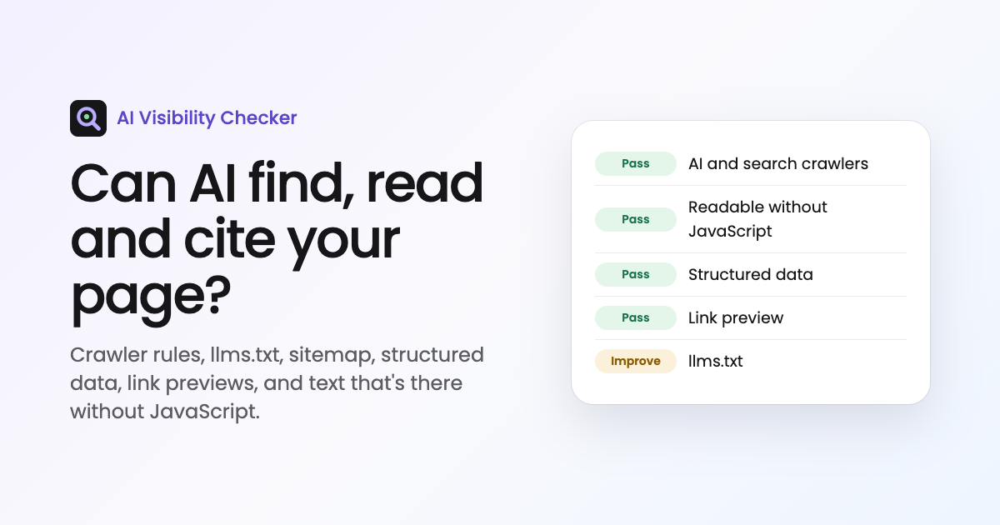

# AI Visibility Checker

**Can AI find, read and cite your page?** Paste a URL and get a report on the signals that decide whether search engines and AI assistants (ChatGPT, Claude, Perplexity, Google's AI Overviews) can use it.

Live: https://chaekim-ai-visibility.vercel.app · Built by [Chae Kim](https://chaekim.vercel.app), with Chris Jackson, my co-founder at Lucent



## What it checks

| Group | Check | Why it matters |
|---|---|---|
| Can AI find it? | Allowed in search | A `noindex` in the page or its headers keeps it out of search and answers. |
| | AI and search crawlers | robots.txt rules for 11 crawlers, split into search and live fetching (blocking hurts visibility) and model training (blocking is a choice). |
| | HTTPS, redirect chain | Served over HTTPS with HTTP redirecting to it; reached in at most one redirect. |
| | Sitemap | Found in robots.txt or at `/sitemap.xml`, and whether it lists the page. |
| | llms.txt | An emerging, optional Markdown guide to a site for AI tools. |
| Can AI read it? | Readable without JavaScript | Words in the raw HTML. Several AI crawlers don't run JavaScript. |
| | Title, one main heading, language | The basics a crawler uses to name the page. |
| | Heading order, image alt text, mobile viewport, mixed content | Structure and assets a crawler can follow and trust. |
| Can AI understand and cite it? | Structured data | JSON-LD that parses, and the `@type`s it declares. |
| | Canonical URL | Whether the page names itself as the URL to credit. |
| | Description, link preview | Meta description; Open Graph title, description and an image that loads. |

The score is the share of weighted checks earned (pass = full, improve = half, fix = none). It's a checklist, not a prediction: nothing can guarantee a ranking or a citation.

If a site refuses the checker (HTTP 401, 403, 429 or 503, common on large sites that block unknown bots), it says so and checks only the public files (robots.txt, sitemap, llms.txt) instead of scoring the page 0.

## Credits

Built with Chris Jackson, my co-founder at [Lucent](https://trylucent.ai). The HTTPS and redirect, mobile viewport, image alt text, heading order, redirect chain and mixed content checks come from the SEO audit playbook we built at Lucent, rewritten here as automatic checks.

## Safety

The API fetches other people's sites, so it only follows `http(s)` URLs, resolves every hostname and refuses private, local and link-local addresses on every redirect hop (cloud metadata endpoints included), caps responses at 2 MB, and times out after 8 seconds. It identifies itself as `AIVisibilityChecker/1.0` and keeps nothing.

## Run it

```bash
npm run dev     # http://localhost:5190, page + API, no dependencies
npm test        # robots.txt matching, address blocking, HTML reading, scoring
```

Deploys to Vercel as static files plus one function, `api/check.js` (`GET /api/check?url=example.com`).

## Layout

```
index.html, app.js, style.css   the page
api/check.js                    the endpoint
lib/fetch-safe.js               public-only fetching with limits
lib/robots.js                   robots.txt parsing and RFC 9309 matching, the crawler list
lib/html.js                     reads title, meta, canonical, JSON-LD, headings and text from raw HTML
lib/audit.js                    the checks, scoring and "fix first"
```
